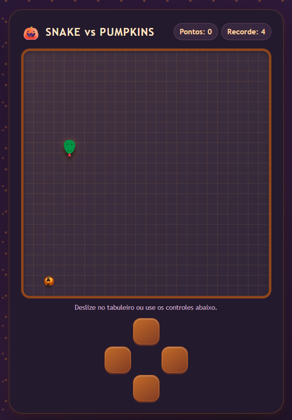
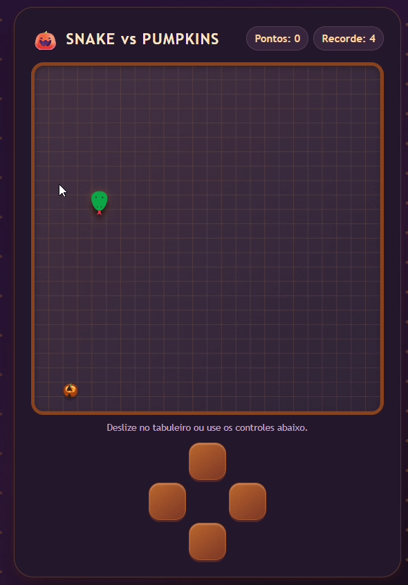

# 🎃 Snake Pumpkins

<p align="center">
  **Uma versão temática de Halloween do clássico jogo Snake!**
</p>

<p align="center">
  Um projeto de desenvolvimento web que combina programação, criatividade e diversão, trazendo uma experiência visual inspirada no universo das abóboras e do Halloween.
</p>

---

## 📸 Preview

<p align="center">
  
</p>


## 🎮 Sobre o projeto

O **Snake Pumpkins** é um projeto desenvolvido como parte dos meus estudos pessoais em programação e desenvolvimento web.

Inspirado no clássico jogo da cobrinha (*Snake Game*), o projeto apresenta uma identidade visual temática de Halloween, explorando elementos gráficos relacionados a abóboras e uma interface voltada para proporcionar uma experiência divertida e interativa.

O objetivo é aplicar conhecimentos de desenvolvimento Front-end, lógica de programação, manipulação de elementos na tela e interação com o usuário.

## ✨ Funcionalidades

- 🎃 Interface com temática de Halloween.
- 🐍 Mecânica inspirada no clássico Snake Game.
- 🎮 Sistema de movimentação do personagem.
- 🍂 Elementos visuais temáticos.
- 🏆 Sistema de pontuação, caso implementado.
- 🔄 Mecânica de reinício da partida, caso implementada.
- 📱 Interface adaptável a diferentes dispositivos, caso implementada.

## 🛠️ Tecnologias utilizadas

| Tecnologia | Aplicação |
|---|---|
| HTML5 | Estrutura da aplicação |
| CSS3 | Estilização, layout e efeitos visuais |
| JavaScript | Lógica do jogo e interatividade |

🎮 Gameplay

<p align="center">
  
</p>


## 🧠 Conceitos aplicados

Durante o desenvolvimento, são explorados conceitos importantes da programação:

- Lógica de programação.
- Manipulação do DOM.
- Eventos e interações do usuário.
- Estruturas condicionais e de repetição.
- Manipulação de variáveis e funções.
- Controle de movimentação.
- Organização e estruturação de código.
- Desenvolvimento de interfaces web.

## 🚀 Como executar o projeto

Você pode executar o projeto localmente seguindo os passos abaixo.

**1. Clone o repositório**

```bash
git clone https://github.com/FatzSeis/NOME-DO-REPOSITORIO.git
```

**2. Entre na pasta do projeto**

```bash
cd NOME-DO-REPOSITORIO
```

**3. Abra no VS Code**

```bash
code .
```

**4. Execute o projeto**

Abra o arquivo `index.html` utilizando a extensão Live Server ou Live Preview no Visual Studio Code.

## 🎮 Como jogar

As instruções de jogabilidade devem acompanhar os controles implementados no projeto.

Exemplo de controles:

| Tecla | Ação |
|---|---|
| ⬆️ Seta para cima | Movimentar para cima |
| ⬇️ Seta para baixo | Movimentar para baixo |
| ⬅️ Seta para esquerda | Movimentar para esquerda |
| ➡️ Seta para direita | Movimentar para direita |

## 📂 Estrutura do projeto

```text
Snake-Pumpkins/
│
├── index.html
├── style.css
├── script.js
│
├── assets/
│   ├── images/
│   ├── sprites/
│   └── sounds/
│
└── README.md
```

*Estrutura ilustrativa: ajuste os nomes das pastas e arquivos conforme a organização real do projeto.*

## 🎯 Objetivo do desenvolvimento

Este projeto faz parte da minha jornada de aprendizado em desenvolvimento web, com foco na construção de aplicações interativas e no aprimoramento das minhas habilidades em JavaScript.

Mais do que reproduzir um jogo clássico, a proposta é desenvolver uma aplicação própria, explorar possibilidades visuais e colocar em prática conceitos fundamentais da programação.

## 🔮 Melhorias futuras

- [ ] Aprimorar animações e efeitos visuais.
- [ ] Implementar novos níveis de dificuldade.
- [ ] Adicionar efeitos sonoros.
- [ ] Melhorar a experiência em dispositivos móveis.
- [ ] Implementar novas mecânicas de jogo.
- [ ] Desenvolver um sistema de recordes.

## 👨‍💻 Desenvolvedor

**Fabrizio Terzi (Fatz)**

Estudante de desenvolvimento de software, interessado em tecnologia, programação e desenvolvimento de aplicações web.

Atualmente, aprofundando conhecimentos em JavaScript, desenvolvimento Front-end e tecnologias voltadas ao Full Stack.

- GitHub: [@FatzSeis](https://github.com/FatzSeis)
- LinkedIn: [Meu perfil profissional](https://www.linkedin.com/)

---

<p align="center">
  🎃 Desenvolvido com criatividade, código e muitas abóboras!
</p>
